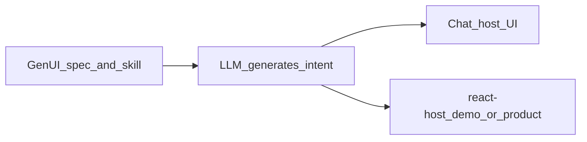

# GenUI — Limitations, root causes, and mitigations

Report for stakeholders and presentation. Complements [provider-matrix.md](provider-matrix.md) and [rendering-profiles.md](../spec/rendering-profiles.md).

---

## Executive summary

GenUI delivers **one specification** across many AI products, but **each chat host renders differently**. The full loop (click → **assistant answer in the same UI**) exists only on **`react-host`**, especially **`pnpm demo`**. Chat install (GitHub URL or paste) gives branded UI and planning **semantics** on some hosts (**Claude Artifacts**, markdown profiles), but usually **not** automatic in-app replies — those use **markdown + “Send this next”** or chat-bridge.

This is a **platform capability gap**, not a failure of the centralized skill.

---

## Root cause #1 — Three different layers (often confused)

| Layer | What it is | Who runs it |
|-------|------------|-------------|
| **Skill / spec** | Rules + GenUI JSON shape | Any model that reads instructions |
| **Chat host UI** | Artifacts, Canvas, plain markdown | Claude, ChatGPT, Gemini, etc. |
| **Product runtime** | `@gen-ui/render`, validation, real clicks | Your app or `apps/demo` |

**Cause of “it works in Claude but not Gemini”:** Claude’s **host** includes an **Artifact renderer**; default **Gemini chat** does not. The skill loads in both; the **pixels** are the host’s job.



---

## Root cause #2 — Rendering profiles (by design)

We document four profiles in [spec/rendering-profiles.md](../spec/rendering-profiles.md):

| Profile | User experience | Typical hosts |
|---------|-----------------|---------------|
| `embedded-ui-host` | Side panel / canvas UI, in-panel interaction | **Claude Artifacts**, some **ChatGPT Canvas** |
| `markdown-ui-host` | Branded cards in message + **Send this next:** | **Gemini chat**, DeepSeek, Grok |
| `json-visible-host` | JSON code block + text instructions | Models over-indexing on “output JSON” |
| `react-host` | Full GenUI runtime | **`pnpm demo`**, future Trish/product |

**Cause:** Provider-agnostic spec intentionally **does not assume** every vendor ships the same embed runtime.

---

## Root cause #3 — “Install skill from GitHub URL”

| Observation | Cause | Mitigation |
|-------------|-------|------------|
| Gemini says it cannot clone/pull the repo | **No file fetch** from arbitrary URLs in chat | Paste [PASTE-BUNDLE.md](../adapters/session/PASTE-BUNDLE.md) or use a **Gem** with instructions |
| Claude fails with repo URL (“robots disallowed”) | GitHub robots.txt + link-provenance + cache — see **L13** / root cause #8 | Raw SESSION-INSTALL URL in the message; Claude Skill zip; paste |
| Skill not persistent in chat | Session-only unless **Skill / Project / Gem** | Claude: upload `adapters/claude-skill/genui.zip`; others: Gem or Project knowledge |

---

## Root cause #4 — Gemini shows JSON after markdown cards

Observed behavior (Nov 5 retest, pasted bundle): heading + two meals + **Send this next** (correct `markdown-ui-host`), then the **full GenUI JSON** with `themeRef: youtube`.

Observed behavior (raw URL, no paste): Gemini could not read the install, described GenUI with **demo** tokens (`#2563eb`), and replied with **only** raw JSON using `themeRef: demo` — the brand the install forbids.

| Factor | Cause |
|--------|--------|
| No URL fetch in Gemini chat | Without the paste, Gemini fills gaps from older public copies of the repo (hence `demo`) |
| Markdown profile allows “optional” JSON | Rules only forbid JSON **first**; Gemini can’t collapse a code block, so it shows in full |
| Large JSON examples in the bundle | Reinforces code-block response |
| No Artifact panel | JSON becomes the only “structured” artifact in the thread |
| Enterprise/partner portals (e.g. Globe) | Same chat UI limits; may add policy banners |

**Mitigation:** Always paste [PASTE-BUNDLE.md](../adapters/session/PASTE-BUNDLE.md) on Gemini. To hide the JSON, follow up with: *Don’t show JSON; markdown cards with Send this next only.* Proposed: change the Gemini overlay to “no JSON unless the user asks.”

---

## Root cause #5 — “Clickable” in chat ≠ `genui.interact` in npm

| In `pnpm demo` | In Gemini / markdown profile |
|----------------|------------------------------|
| Real DOM click → `onAIRequest` → **mock assistant reply in-panel** | User replies **1**, **2**, or pastes **Send this next** |
| `@gen-ui/core` validates events | Same **prompt templates**, manual chat-bridge |

**Cause:** Chat products do not execute our monorepo packages inside the conversation.

---

## Provider comparison (Claude-like UI)

| Provider | Claude-like embedded panel? | GenUI session install | Best demo for stakeholders |
|----------|----------------------------|------------------------|----------------------------|
| **Claude web** + Artifacts | **Yes** | URL or paste | **Primary chat demo**; branded Artifact confirmed Nov 5 (L12 did not recur) |
| **ChatGPT web** + Canvas | **Often** (plan-dependent) | URL or paste | Secondary chat demo; correct meals, no brand colour in Markdown — see L10 |
| **Gemini chat / Flash** | **No** (default) | **Paste only** | Show markdown + Send this next; explain profile |
| **Gemini Canvas** (if available) | Partial / product-specific | Paste | Verify on your account before presenting |
| **DeepSeek** | **No** | URL or paste | Markdown profile; most literal result |
| **Grok** | **No** (can style an install card) | URL or paste | Markdown profile; may embellish — see L14 |
| **`pnpm demo`** | **Yes** (real runtime) | Clone repo | **Strongest technical proof** |

---

## Limitations list (explicit)

| # | Limitation | Cause | Mitigation / status |
|---|------------|-------|---------------------|
| L1 | Not identical UI across all AI chats | Host renderers differ | Rendering profiles + overlays |
| L2 | Gemini cannot install from GitHub URL | No repo fetch in chat | PASTE-BUNDLE, Gem instructions |
| L3 | Gemini appends the full JSON after the cards | “Optional” JSON allowed + no collapse in Gemini | Visual-first bundle; user follow-up prompt; proposed “no JSON unless asked” overlay |
| L4 | No auto AI reply on click in markdown hosts | No shared runtime in chat | Chat-bridge; use **`pnpm demo`** for click→answer |
| L5 | Chat ≠ coding agent | Cursor/CLI vs web chat | Separate adapter paths, same spec |
| L6 | Trish not integrated yet | Phase 1 = platform only | [future-trish-integration.md](future-trish-integration.md) |
| L7 | 917v brand not shipped | Generic demo brand first | `branding/917v/` planned |
| L8 | v1 component allowlist | Security / validation | Extensible catalog in spec minor versions |
| L9 | Enterprise Gemini variants | Partner policies, model tier | Test on exact portal you demo |
| L10 | ChatGPT generic recipe UI | Host **native widgets** (images, badges) override GenUI; model improvises meals | Strict [chatgpt-web.md](../adapters/session/providers/chatgpt-web.md) overlay; user follow-up prompt; prefer `pnpm demo` for brand proof |
| L11 | Partial repo browse on URL install | Host reads random spec files, skips tokens | Fetch [SESSION-INSTALL.md](../adapters/session/SESSION-INSTALL.md) one-shot; [README.md](../README.md) / [GENUI-SESSION.md](../GENUI-SESSION.md) hooks |
| L12 | Claude web native interactive planner | Host ships a prefab meal UI (card grid, time filter, “Plan this” chips) instead of a custom Artifact; model invents meals; install rules not re-applied on later turns | Hardened install rules (exact reference options, rebuild Artifact every turn, forbidden-substitution list) + strict [claude-web.md](../adapters/session/providers/claude-web.md) overlay; drift-recovery prompt (root cause #7); prefer `pnpm demo` for proof |
| L13 | Claude web cannot install from repo URL (“robots disallowed”, reads outdated files) | GitHub `robots.txt` blocks `/tree/`, `/raw/`, `/commits/` for AI fetchers; Claude only fetches user-supplied/previously-seen URLs; fetch results can be cached | Raw SESSION-INSTALL URL in the user message (self-contained, no follow-up fetch); `installVersion` stamp exposes stale copies; commit-pinned URL; Claude Skill zip; paste (root cause #8) |
| L14 | Grok embellishes the reference picker (new heading, tagline, stock food photo) | Model optimizes for an appealing answer even after repeating the “no stock photos” rule; Markdown overlay doesn’t require the heading verbatim | Proposed: Markdown overlays require the document heading verbatim and forbid images not in the document; retest (root cause #9) |
| L15 | OpenUI Lang cannot carry branding or every GenUI detail | OpenUI Lang has no theme/meta slot; positional catalog; GenUI safe-rendering forbids OpenUI's URL/tool actions | `themeRef`/`meta` passed out-of-band; `genui` provenance in `@ToAssistant` context keeps `ai.request` lossless; documented normalizations and rejections in [spec/openui-interop.md](../spec/openui-interop.md) |

---

## Root cause #6 — ChatGPT “looks good” but isn’t GenUI

Observed: skill loads (`chatgpt-web`, brand `demo`, `markdown-ui-host`) but the reply shows **four unrelated recipes**, stock photos, gray/green badges — **no demo blue**.

| Factor | Cause |
|--------|--------|
| Profile `markdown-ui-host` | ChatGPT uses its own rich list UI, not your CSS |
| No reference-meal enforcement in first install | Model optimizes for “helpful dinner ideas” |
| `themeRef` in JSON | Not wired to ChatGPT’s native card renderer |
| Images | Host feature; not in GenUI v1 catalog |

**Mitigation:** Re-prompt with reference scenario + hex colors; use **Canvas/HTML** when available; demo **`pnpm demo`** for true branded clicks.

---

## Root cause #7 — Claude web shows its own interactive planner

Observed: install fetches and confirms, but *“pick a weeknight dinner”* renders Claude’s built-in interactive meal UI — five invented meals, a time filter, blue “Plan this” chips — instead of the reference Artifact.

| Expected (GenUI on Claude) | What appears instead |
|----------------------------|----------------------|
| Exactly two options (salmon, ramen) from the reference document | Several invented meals |
| Token primary **#FF0000** (youtube) | Blue / default Claude chrome |
| **Send this next:** with the interpolated `planMeal` prompt | “Plan this” product chips |
| Simple picker, no extra widgets | Time filter not in the document |

| Factor | Cause |
|--------|--------|
| Artifact vs native interactive UI | Claude optimizes food/planning prompts toward a prefab layout; host UI wins over `themeRef` (same class as L10) |
| Reference scenario is soft in chat | Model prior is “offer variety” unless bound to the two cards |
| Branding isn’t automatic in Artifacts | **#FF0000** appears only if the model writes that CSS |
| Install ≠ every reply | Install can succeed in prose while a later turn falls back to generic planner behavior |

**Mitigation (shipped):** [SESSION-INSTALL.md](../adapters/session/SESSION-INSTALL.md) / [PASTE-BUNDLE.md](../adapters/session/PASTE-BUNDLE.md) now require exactly the reference options, rebuilding the Artifact on **every** GenUI reply, and list forbidden substitutions (native planners, card-grid pickers, time filters, “Plan this” chips, blue/neutral chrome). [claude-web.md](../adapters/session/providers/claude-web.md) makes the Artifact mandatory per turn.

**If it still drifts**, paste:

```text
Build a React Artifact exactly like meal-artifact.reference.tsx with ONLY the two meals
from meal-planning.document.json (Sheet-pan salmon, Miso ramen bowl), YouTube #FF0000,
Send this next with the planMeal prompt on each, and no extra meals or filters.
```

**Correct result:** confirmation names youtube / #FF0000; two red-accent cards; each option has **Send this next:** with the full cooking prompt. Anything else means Claude is in planner mode, not GenUI mode.

---

## Root cause #8 — Claude web: “robots disallowed” on repo URL install

Observed: *“Install the GenUI skill for this session from https://github.com/noahtan917/gen-ui”* → Claude read only `INSTALL-SKILL.md` and `spec/session-bootstrap.md` (an **outdated** version listing `branding/demo`), every other file returned “robots disallowed”, and it said its skills folder is read-only.

| Factor | Cause |
|--------|--------|
| “robots disallowed” | `github.com/robots.txt` disallows `/*/tree/`, `/*/raw/`, `/*/*/commits/` for `ClaudeBot` / `anthropic-ai`. `/blob/` file pages pass; directory navigation does not. `raw.githubusercontent.com` has no robots.txt. |
| Can’t reach the raw file | Claude only fetches URLs from the user message or earlier fetch results — it will not construct `raw.githubusercontent.com/...` |
| Outdated content | Fetch results can be served from cache, so fixes on `main` may not reach the model |
| “Skills folder is read-only” | “Install the skill” wording targets Claude’s persistent Skills feature |

**Mitigation (shipped, OpenSpec 005):** the install prompt carries the **raw** SESSION-INSTALL URL and says “load … for this chat”; SESSION-INSTALL inlines everything (reference layout, overlays) and forbids follow-up fetches; `installVersion` in the confirmation exposes stale copies (fix: commit-pinned URL); persistent install via generated Claude Skill (`adapters/claude-skill/genui.zip`); paste works on any host.

---

## Root cause #9 — Grok decorates the reference picker

Observed (Nov 5, raw URL): install confirmed as a styled dark card with red **YOUTUBE** / `#FF0000`, plus a list of the session rules it had activated (two meals, **Send this next**, no stock photos). The dinner reply then used the heading *“What’s for dinner tonight?”*, the tagline *“Two delicious options. One easy decision.”*, and a large stock food photo.

| Factor | Cause |
|--------|--------|
| Heading and tagline changed | Markdown overlay asks for “branded markdown cards” but not the document heading verbatim |
| Stock photo | Model prior for food prompts; the ban is in the general rules, not the Grok overlay |
| Styled install card | Grok can render some styled blocks — the brand reached the confirmation but not the picker |

**Mitigation (proposed):** in Markdown overlays (Grok, DeepSeek, Gemini, ChatGPT fallback), require the reference heading verbatim and forbid any image or emoji not in the document. Retest Grok before using it live.

---

## Cross-provider test results (Nov 5, 2026)

Install file `installVersion 401e4c93`, brand **youtube** (#FF0000). Fresh chat per provider → install → *Help me pick a weeknight dinner*.

| Provider | Install | Profile | 2 reference meals + **Send this next** | Brand red | Drift / notes |
|----------|---------|---------|------------------------------------------|-----------|---------------|
| Claude web | Raw URL ✅ | `embedded-ui-host` | ✅ in a React Artifact | ✅ header, badge, accents | None — L12 native planner did not recur |
| ChatGPT web | Raw URL ✅ | `markdown-ui-host` | ✅ | ❌ (Markdown) | Chose Markdown over Canvas; no photos (L10 not reproduced) |
| DeepSeek | Raw URL ✅ | `markdown-ui-host` | ✅; rebuilt correctly on a later turn | ❌ (Markdown) | Emoji markers (cosmetic) |
| Grok | Raw URL ✅ | `markdown-ui-host` | ⚠️ layout drifted | ⚠️ install card only | New heading, tagline, stock photo (L14) |
| Gemini | Raw URL ❌ | — | ❌ raw JSON, `demo` blue | ❌ | Cannot fetch (L2) |
| Gemini | Paste ✅ | `markdown-ui-host` | ✅ | ❌ (Markdown) | Full JSON appended (L3) |

**Conclusion:** the GenUI contract is provider-agnostic — the same install produced the same options and the same `planMeal` prompts on all five providers. Rendering is host-specific (only Claude draws the brand), and Gemini needs the paste bundle.

**Not yet covered:** sending the **Send this next** prompt and checking the plan (manual test step 5), and repeat runs (3–5 per provider) to measure consistency.

---

## What is **not** a limitation (clarify in Q&A)

- **One centralized spec** — working; adapters link to `spec/`.
- **Same interaction semantics** — `ai.request` templates came through word for word on Claude, ChatGPT, DeepSeek, and Gemini (Nov 5).
- **Validation and React renderer** — working in repo; 8 tests passing.
- **Multi-provider session skill** — working with paste; URL where host allows fetch.

---

## Recommended presentation narrative (60 seconds)

1. We built **one GenUI contract** so we do not maintain five copies of the rules.
2. **Claude** can show an **Artifact**; **Gemini chat** shows **markdown + follow-up prompts** — same skill, different **rendering profile**.
3. **Production** will use **`react-host`** in the product, not the chat vendor’s panel.
4. We documented **limitations and causes** so expectations match reality before Trish integration.

---

## Related docs

- [chat-session-manual-test.md](chat-session-manual-test.md)
- [chat-session-setup.md](chat-session-setup.md)
- [install-gemini.md](install-gemini.md)
- [PROGRESS-REPORT.md](PROGRESS-REPORT.md)
