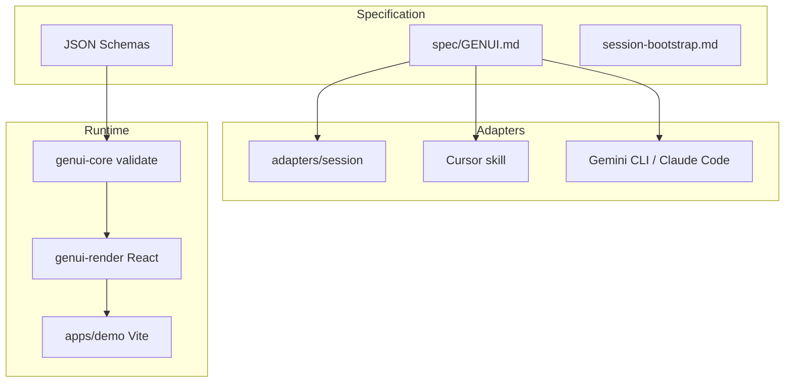

# GenUI — Progress Report

**Project:** Provider-agnostic Generative UI (`gen-ui`)  
**Repository:** https://github.com/noahtan917/gen-ui  
**Status:** Phase 1 complete (foundation + multi-provider session skill)  
**Last updated:** November 2026

---

## Executive summary

We built **one centralized GenUI specification** that multiple AI ecosystems can consume through **thin adapters**, plus a **reference runtime** that validates JSON, renders safe interactive UI, and dispatches structured AI requests when users click options.

The goal matches the demo you saw elsewhere (install skill → branded UI → click → contextual planning), but implemented in a **maintainable, provider-neutral** way instead of a single-vendor hack.

**Trish product integration is intentionally deferred** until this foundation is reviewed; a checklist exists for later.

---

## Problem we solved

| Pain                                          | Our approach                                       |
| --------------------------------------------- | -------------------------------------------------- |
| Duplicated GenUI rules per AI vendor          | Single SSOT under `spec/`                          |
| Static AI responses instead of interactive UI | GenUI JSON + `ai.request` actions + host rendering |
| Random visuals                                | `themeRef` + brand packs (`branding/demo/`)        |
| Chat vs coding agent confusion                | Separate **rendering profiles** and entry paths    |
| “Install from GitHub” fails on some hosts     | **PASTE-BUNDLE** for Gemini, DeepSeek, etc.        |

---

## Architecture (three layers)



**Agent time:** models read spec/adapters and emit GenUI JSON.  
**Runtime time:** `@gen-ui/core` + `@gen-ui/render` (or chat host UI) render and handle clicks.

---

## Deliverables completed

### 1. Engineering specification

- [`spec/GENUI.md`](../spec/GENUI.md) — principles, component catalog v1, actions
- [`spec/interaction-contract.md`](../spec/interaction-contract.md) — `genui.interact`, `ai.request` prompts
- [`spec/rendering-profiles.md`](../spec/rendering-profiles.md) — react-host, embedded-ui-host, markdown-ui-host
- [`spec/session-bootstrap.md`](../spec/session-bootstrap.md) — one session install flow
- [`spec/branding-extraction.md`](../spec/branding-extraction.md) — how to attach real site brands later
- JSON Schemas in [`spec/contracts/`](../spec/contracts/)

### 2. Reference implementation (TypeScript monorepo)

| Package          | Role                                             |
| ---------------- | ------------------------------------------------ |
| `@gen-ui/core`   | Zod validation, prompt resolution, state updates |
| `@gen-ui/render` | Allowlisted React registry, `onAIRequest`        |
| `@gen-ui/demo`   | Meal-planning host (click card → mock streamed assistant reply) |

**Tests:** 8 passing (validation, render, interactions, adapter smoke, brand fixture).

### 3. Multi-provider adapters

**Chat session (centralized):**

- [`adapters/session/SKILL.md`](../adapters/session/SKILL.md)
- [`adapters/session/PASTE-BUNDLE.md`](../adapters/session/PASTE-BUNDLE.md) — single-file install for hosts without GitHub fetch
- Provider overlays: Claude web, ChatGPT, Gemini app, DeepSeek, Grok, generic

**Coding agents:**

- Cursor, Claude Code, Gemini CLI, OpenAI-style AGENTS.md

### 4. Branding

- [`branding/demo/`](../branding/demo/) — default demo tokens (917v pack planned)

### 5. Documentation & governance

- OpenSpec proposals [`001`](../openspec/proposals/001-provider-agnostic-genui.md), [`002`](../openspec/proposals/002-chat-session-multi-provider.md)
- Install guides: [`INSTALL-SKILL.md`](../INSTALL-SKILL.md), [`docs/install-gemini.md`](install-gemini.md)
- Manual test: [`docs/chat-session-manual-test.md`](chat-session-manual-test.md)

### 6. Publication

- Pushed to **https://github.com/noahtan917/gen-ui** (branch `main`)

---

## Reference demo scenario (current)

**Topic:** Weeknight meal planning (replacing early travel/Boracay examples).

- Cards: **Sheet-pan salmon** (Mediterranean), **Miso ramen bowl** (Japanese)
- Click → resolved `ai.request` prompt → **Assistant panel** (ingredients, steps, time; mock LLM in demo)
- Local demo: `pnpm demo`

Same JSON drives chat hosts and the Vite app.

---

## How to demo tomorrow

### A. Live app (strongest technical proof)

```bash
git clone https://github.com/noahtan917/gen-ui.git
cd gen-ui && pnpm install && pnpm build && pnpm demo
```

Click **Sheet-pan salmon** → **Assistant** panel streams the weeknight plan (no copy-paste). Expand **Request details** only if the room wants to see the resolved payload.

### B. Chat AI (multi-provider story)

1. **Claude web** (if Artifacts + URL fetch): install prompt from [`INSTALL-SKILL.md`](../INSTALL-SKILL.md)
2. **Gemini:** paste [`PASTE-BUNDLE.md`](../adapters/session/PASTE-BUNDLE.md) — _cannot fetch GitHub_
3. Ask: _Help me pick a weeknight dinner — show GenUI meal options I can click._

### C. Cursor

Open repo → **genui** skill → ask for GenUI JSON for meal cards.

---

## Limitations and causes (presentation section)

Full report: **[LIMITATIONS-AND-CAUSES.md](LIMITATIONS-AND-CAUSES.md)**

**Headline:** One spec works everywhere; **embedded UI like Claude Artifacts does not**.

| Symptom | Root cause |
|---------|------------|
| Gemini outputs JSON, not a side panel | No Artifact runtime; skill also mentioned JSON → model emits code blocks |
| “Install from GitHub” fails on Gemini | Chat cannot fetch arbitrary repos → paste `PASTE-BUNDLE.md` |
| Clicks don’t fire `onAIRequest` in chat | Chat hosts don’t run `@gen-ui/render` → **chat-bridge** (“Send this next”) |
| Demo looks different per vendor | **Rendering profiles** (`embedded-ui-host` vs `markdown-ui-host` vs `react-host`) |

**Best demos for tomorrow:**

1. **`pnpm demo`** — full runtime (click → auto assistant reply).  
2. **Claude web + Artifacts** — closest to “reference” chat UX.  
3. **Gemini** — show markdown options + **Send this next**; explain limitation honestly.

---

## Key learnings (worth stating in the presentation)

1. **Not all chat products can “install from GitHub URL.”** Gemini explicitly refuses; paste bundle is required.
2. **Same skill, different rendering profile** — Artifacts vs markdown cards vs local React.
3. **Interactivity in chat** often means **chat-bridge** (“Send this next: …”) plus in-UI feedback, not a shared npm renderer.
4. **Central spec scales** — adding a provider is a small overlay file, not copying the whole skill.
5. **Limitation ≠ project failure** — product integration uses `react-host`; chat is for skill validation and sales narrative.

---

## Out of scope (by design)

- Trish repository wiring ([`docs/future-trish-integration.md`](future-trish-integration.md))
- Production 917v brand pack (structure ready under `branding/`)
- Consumer chat native execution of `@gen-ui/render`

---

## Roadmap (suggested talking points)

| Phase     | Work                                                                |
| --------- | ------------------------------------------------------------------- |
| **Now**   | Present foundation; gather feedback on spec v1                      |
| **Next**  | `branding/917v/` + customer site extraction pilot                   |
| **Then**  | Trish (or first product) registry overrides + `onAIRequest` backend |
| **Later** | Optional hosted “skill URL” or Gem templates per provider           |

---

## Metrics / proof points

- 1 spec source, 6+ provider entry paths
- 72 files in initial commit; session + paste bundle follow-up
- Monorepo: 2 packages + demo app
- Public repo for sharing install instructions

---

## Links for slides

| Resource               | URL                                                                                       |
| ---------------------- | ----------------------------------------------------------------------------------------- |
| Repo                   | https://github.com/noahtan917/gen-ui                                                      |
| Paste install (Gemini) | https://raw.githubusercontent.com/noahtan917/gen-ui/main/adapters/session/PASTE-BUNDLE.md |
| Architecture           | [docs/architecture.md](architecture.md)                                                   |
| Provider matrix        | [docs/provider-matrix.md](provider-matrix.md)                                             |
| Limitations report     | [docs/LIMITATIONS-AND-CAUSES.md](LIMITATIONS-AND-CAUSES.md)                               |
