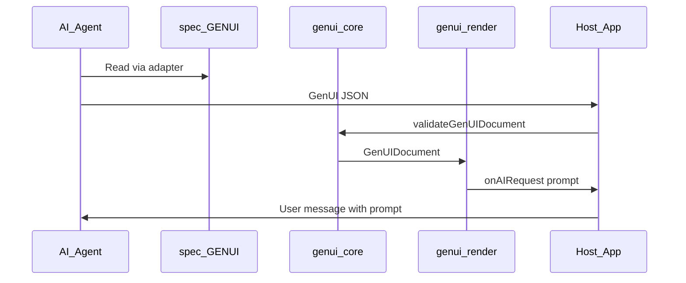
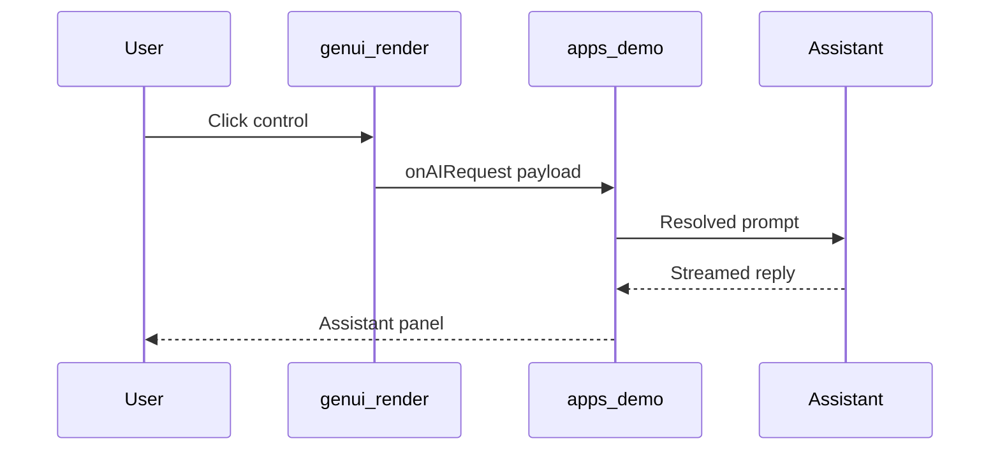

# GenUI architecture

## Layers

| Layer | Location | Role |
|-------|----------|------|
| Specification | `spec/` | Authoritative rules, schemas, branding workflow |
| Adapters | `adapters/` | Provider-specific entry points |
| Core | `packages/genui-core` | Validate, normalize, resolve interactions |
| Render | `packages/genui-render` | Allowlisted React registry, event dispatch |
| Demo | `apps/demo` | Reference host: `onAIRequest` → mock streamed assistant reply |

## Agent time vs runtime (chat-bridge path)

Many chat hosts cannot run the React runtime. The host may only surface the resolved prompt for the user to send on the next turn.

Coding agents consume skills; consumer chat products often stop at chat-bridge unless they embed `react-host`.

## Reference host (`react-host`)

[`apps/demo`](../apps/demo) implements the full loop: validate → render → resolve prompt → **invoke assistant in-app** (mock stream today; real LLM in product).

## Security (v1)

- Component allowlist in `@gen-ui/render`
- Validation before render in `@gen-ui/core`
- No `html` / `script` types in schema

## Versioning

Document field `genuiVersion` follows semver. Breaking changes require a major bump and adapter notes.
