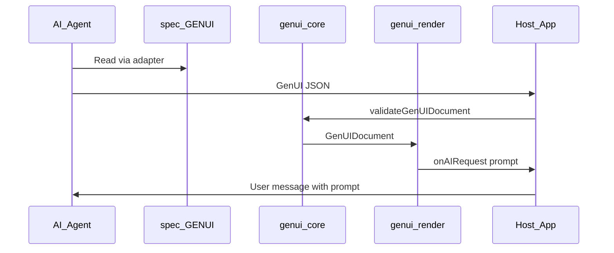

# GenUI architecture

## Layers

| Layer | Location | Role |
|-------|----------|------|
| Specification | `spec/` | Authoritative rules, schemas, branding workflow |
| Adapters | `adapters/` | Provider-specific entry points |
| Core | `packages/genui-core` | Validate, normalize, resolve interactions |
| Render | `packages/genui-render` | Allowlisted React registry, event dispatch |
| Demo | `apps/demo` | Reference host integrating `onAIRequest` |

## Agent time vs runtime

Coding agents consume skills; the host application validates and renders. Consumer chat products do not automatically execute this pipeline unless integrated.

## Security (v1)

- Component allowlist in `@gen-ui/render`
- Validation before render in `@gen-ui/core`
- No `html` / `script` types in schema

## Versioning

Document field `genuiVersion` follows semver. Breaking changes require a major bump and adapter notes.
