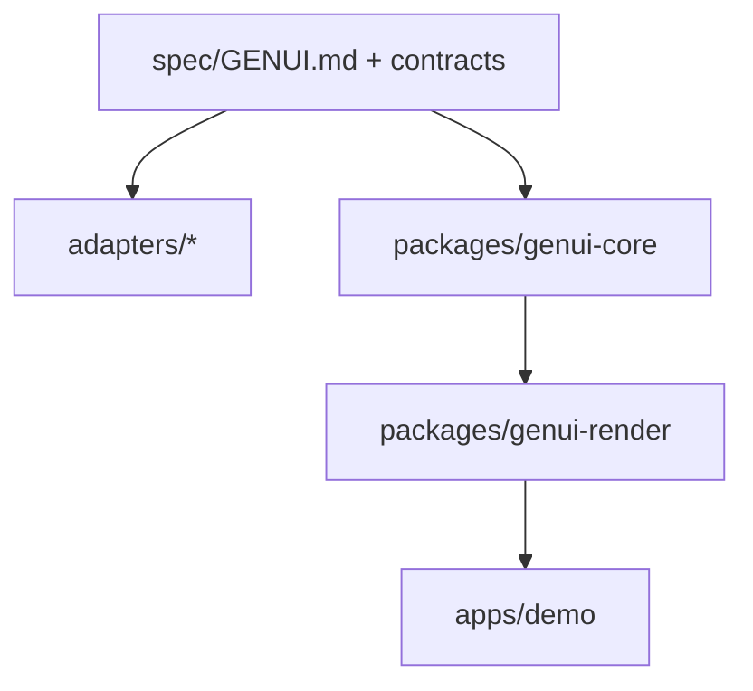

# OpenSpec 001: Provider-Agnostic Generative UI

**Status:** Approved for implementation  
**Date:** 2026-11-04

## Problem statement

Teams need AI agents to produce **interactive** user interfaces that respect a host site’s branding. Each provider (Claude, Gemini, OpenAI, etc.) uses different instruction formats. Duplicating GenUI rules per provider creates drift and maintenance cost.

## Goals

- One authoritative GenUI specification under `spec/`.
- Lightweight provider adapters that reference the spec, not copy it.
- A versioned UI DSL with JSON Schema contracts.
- Reference runtime: validate, render safely, dispatch interactions to an AI handler.
- Vite demo proving click → resolved prompt → host assistant response (mock LLM v1).

## Non-goals (this phase)

- Trish repository integration.
- Arbitrary HTML/script injection in v1.
- Chat-native rendering inside every provider’s consumer UI (distinction: coding agents vs chat products).

## Architecture

## Contract versioning

- Root field `genuiVersion` (semver string, e.g. `"1.0.0"`).
- Minor/patch: additive schema changes only.
- Major: breaking component or event shape changes; adapters document migration.

## Provider matrix

| Provider | Adapter path | Mechanism |
|----------|--------------|-----------|
| Cursor | `adapters/cursor/.cursor/skills/genui/SKILL.md` | Agent skill + links to spec |
| Claude Code | `adapters/claude-code/CLAUDE.md` | Project instructions |
| Gemini CLI | `adapters/gemini/GEMINI.md` | Context file + `@` imports |
| OpenAI / Codex-style | `adapters/openai/AGENTS.md` | AGENTS.md convention |
| DeepSeek / Grok | `adapters/_template` | Verify official format before ship |

## Rendering and security

- v1 component allowlist only; unknown types → fallback UI.
- No `html` or `script` node types.
- Validation runs before render; invalid documents surface errors to the model via structured hints.

## Acceptance criteria

- [x] Single spec source; adapters link without duplicating core rules.
- [x] `genui-core` validates sample and rejects invalid DSL.
- [x] Demo: option card click emits contextual AI request.
- [x] Form interaction updates UI state.
- [x] Tests for validation, render, interactions, adapter path smoke check.
- [x] Documentation for adding a provider.

## Risks and mitigations

| Risk | Mitigation |
|------|------------|
| Gemini `AGENTS.md` not loaded by default | Ship `.gemini/settings.json.example` |
| Provider context drift | Adapters are thin; spec is SSOT |
| Agents emit invalid JSON | Zod/JSON Schema + retry hints in spec |

## Trish design system

The 917V design system is vendored in [design-system/](../../design-system/).
